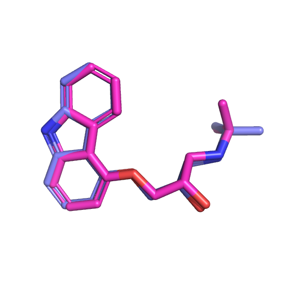
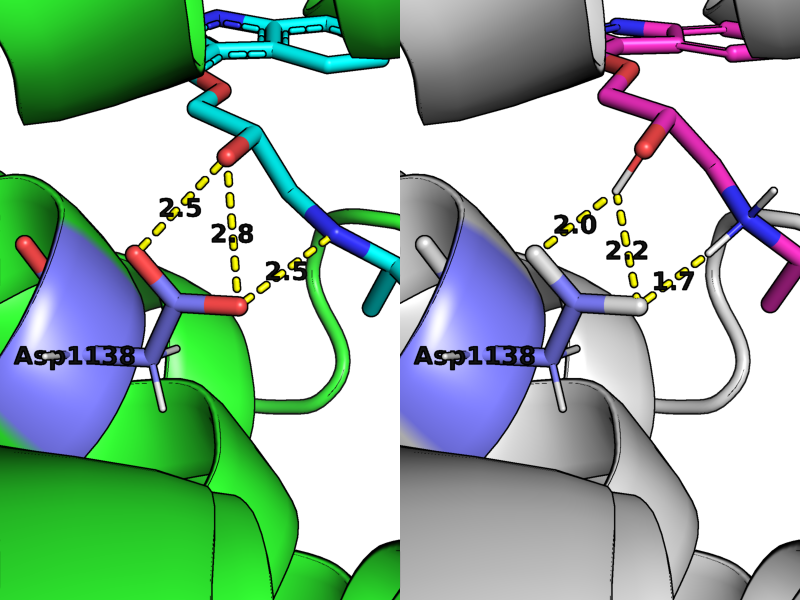

# Molecular Docking Validation & Cross-Docking to the Human β₁-Adrenergic Receptor (PDB: 7BVQ).

## 💻 Redocking of the co-crystallized inverse agonist **carazolol** (`CAU`)

```text
0%   10   20   30   40   50   60   70   80   90   100%
|----|----|----|----|----|----|----|----|----|----|
***************************************************

mode |   affinity | dist from best mode
     | (kcal/mol) | rmsd l.b.| rmsd u.b.
-----+------------+----------+----------
1       -9.9       0.000      0.000 

RMSD = 0.623
```
<p align="center">
&nbsp;

</p>


